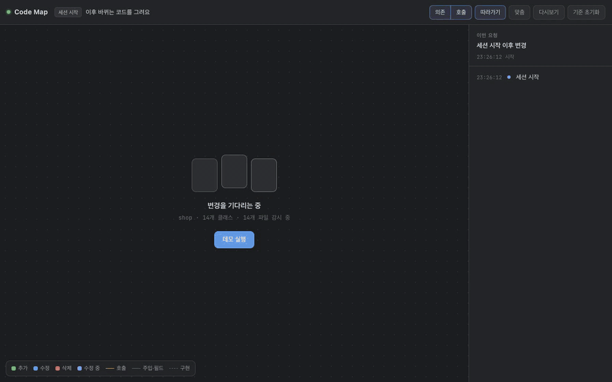

# Code Map

Claude Code가 Java/Kotlin + Spring 코드를 고치는 동안, **어느 레이어의 어느 클래스에서 어떤 메서드·프로퍼티가 추가·수정·삭제되고 메서드 호출 관계가 어떻게 바뀌는지** 세션별로 브라우저에 실시간으로 그려 주는 Claude Code 플러그인입니다.

> A Claude Code plugin that draws a live class & call diagram of what Claude is changing in your Java/Kotlin + Spring code — per session, in your browser. [English below](#english)



[MP4로 보기](docs/demo.mp4) · 데모는 예제 주문 서비스에 "결제 기능 추가 + 레거시 결제 정리"를 하는 과정입니다.

## 설치

Claude Code에서:

```text
/plugin marketplace add ktae23/code-map
/plugin install code-map@ktae23
```

Claude Code 2.1.275 이상이면 한 줄로도 됩니다: `/plugin install code-map --marketplace ktae23/code-map`

필요한 것은 **Node 20 이상**뿐입니다. `npm install`이 없고 외부 패키지도 쓰지 않습니다.

## 쓰는 법

1. 설치 후 Claude Code 세션을 새로 열면 `Code Map: http://127.0.0.1:4747/s/xxxxxxxx` 링크가 뜹니다.
2. 그 주소를 브라우저 옆 창에 띄워 두고 평소처럼 Claude에게 기능 개발이나 수정을 시킵니다.
3. 링크를 놓쳤으면 `/code-map`(또는 "코드맵 열어줘")으로 지금 세션의 지도를 엽니다.

세션마다 주소가 따로 있고, 각 화면에는 **그 세션이 고친 코드만** 나옵니다. 같은 저장소에서 여러 세션을 동시에 돌려도 섞이지 않습니다. 전체 세션 목록은 `http://127.0.0.1:4747`에서 볼 수 있습니다.

## 화면에서 보이는 것

| 표시 | 뜻 |
|---|---|
| 열 | Controller · Service · Repository · Domain · DTO·기타 (애너테이션과 이름 규칙으로 분류) |
| 초록 / 파랑 / 빨간 취소선 | 이번 요청에서 추가 / 수정 / 삭제 (IntelliJ 변경 색과 같은 체계) |
| 보라색 깜빡임 | Claude가 지금 고치려는 파일 |
| 회색 화살표 | 생성자 주입·필드 의존 (`private val repo: OrderRepository`, Lombok `@RequiredArgsConstructor` final 필드) |
| 점선 + 빈 삼각형 | 인터페이스 구현 |
| 멤버 줄을 잇는 주황 선 | 메서드 호출. 초록은 새로 생긴 호출, 빨간 점선은 끊긴 호출 |
| 흐린 카드 | 바뀐 코드와 연결된 클래스(맥락). 호출로 이어진 멤버만 보여 줌 |
| 라우트 태그 | `POST /orders/{id}/pay`처럼 클래스·메서드 매핑을 합친 경로 |

- **영향 범위**: 수정된 메서드를 부르는 쪽도 함께 그려서 "이 수정이 어디에 영향을 주는지"가 보입니다.
- 멤버나 클래스 이름을 누르면 이번 요청 전후의 코드 diff가 열립니다. 멤버에 마우스를 올리면 그 멤버의 호출선만 강조됩니다.
- 오른쪽 타임라인에 변경이 순서대로 쌓이고, **다시보기**로 처음부터 재생할 수 있습니다.
- 상단의 **의존 / 호출** 버튼으로 관계선을 켜고 끕니다. 드래그로 이동, ⌘/Ctrl + 휠로 확대·축소.

## 동작 방식

```text
Claude Code 훅 ──▶ 로컬 서버(127.0.0.1:4747) ──SSE──▶ 브라우저
 SessionStart       · 세션 등록, 저장소 루트 찾기
 UserPromptSubmit   · 요청마다 기준 시점 저장
 PreToolUse         · "수정 중" 표시
 PostToolUse        · 고친 파일을 바로 다시 읽고 이 세션 몫으로 기록
 Stop / SessionEnd  · 요청 끝 → 전체 맞춤
                    + 파일 감시(셸·IDE로 고친 것도 반영)
```

- 서버는 첫 세션이 열릴 때 훅이 백그라운드로 띄우고, 할 일이 없으면 스스로 종료합니다.
- 파서는 직접 작성했습니다. 클래스·생성자·프로퍼티·필드·메서드·애너테이션·상속을 읽고, 메서드 본문에서는 호출만 뽑습니다. 호출 대상은 필드·생성자 파라미터·메서드 파라미터·지역 변수·반환 타입을 따라가 정적으로 추론합니다.

## 설정 (환경 변수)

| 변수 | 기본값 | 설명 |
|---|---|---|
| `CODE_MAP_PORT` | `4747` | 서버 포트 |
| `CODE_MAP_BROWSER` | (기본 브라우저) | `/code-map`이 열 브라우저 앱 이름(macOS), 예: `Arc`, `Aside` |
| `CODE_MAP_QUIET` | | `1`이면 세션 시작 때 링크를 띄우지 않음 |
| `CODE_MAP_DISABLE` | | `1`이면 훅이 아무것도 하지 않음 |

## 보안·개인정보

- 서버는 `127.0.0.1`에만 열리고 `Host`/`Origin` 헤더를 검사해 다른 사이트가 소스를 읽어 가지 못하게 막습니다.
- 외부로 아무것도 보내지 않습니다. 텔레메트리도 없습니다. 프롬프트와 코드는 서버 메모리에만 있고 종료하면 사라집니다.
- 외부 의존성이 없어 공급망 위험이 없고, 사내 PC에도 그대로 쓸 수 있습니다.

## 플러그인 없이 쓰기

```bash
git clone https://github.com/ktae23/code-map
node code-map/server.mjs /path/to/my-spring-project   # 이 폴더의 모든 변경을 그림
node code-map/server.mjs --demo                         # 데모: http://127.0.0.1:4747/s/demo
```

훅만 직접 걸고 싶다면 `hooks/settings.example.json`을 `~/.claude/settings.json`이나 프로젝트의 `.claude/settings.local.json`에 넣고 경로를 바꿉니다.

## 한계

- 정적 추론이라 잡지 못하는 호출이 있습니다: 람다의 `it`, 컬렉션 원소, 상속받은 Spring Data 메서드(`findById` 등), 리플렉션·프록시. 오버로드는 이름으로 연결합니다.
- 컴파일러가 아니라 선언부 파서입니다. 괄호가 안 맞는 중간 저장 상태는 건너뛰고, 맞춰지면 반영합니다.
- 같은 저장소에서 여러 세션이 동시에 작업할 때, 셸 명령으로 고친 파일은 작업 중인 모든 세션 화면에 보일 수 있습니다. Edit·Write 도구로 고친 파일은 정확히 그 세션에만 보입니다.
- macOS에서 개발·검증했습니다. Linux는 Node 20 이상에서 동작해야 하고, Windows는 아직 확인하지 않았습니다.

## 파일 구성

```text
.claude-plugin/     플러그인·마켓플레이스 매니페스트, 아이콘
hooks/              hooks.json(훅 설정), notify.mjs(훅 → 서버), open.mjs(/code-map)
skills/code-map/    /code-map 스킬
server.mjs          로컬 서버: 세션·프로젝트 관리, 파일 감시, SSE
lib/parse.mjs       Java/Kotlin 선언부 + 호출 파서
lib/model.mjs       레이어 분류, 의존·호출 그래프, 두 시점 비교
lib/project.mjs     저장소 하나의 파일·클래스 상태
lib/session.mjs     Claude 세션 하나의 화면 상태
public/             화면(HTML/CSS/JS, 외부 라이브러리 없음)
demo/               예제 Spring 프로젝트와 데모 시나리오
```

## English

**Code Map** is a Claude Code plugin that shows, in a browser tab next to your terminal, a live diagram of what Claude is changing in Java/Kotlin + Spring code.

- Classes are laid out in Spring layers (Controller → Service → Repository → Domain → DTO).
- Added / modified / deleted members are highlighted as they happen; the file Claude is about to edit pulses.
- Dependency arrows (constructor injection, fields, implements) and **method-to-method call lines** — including new calls, removed calls, and callers of modified methods (impact).
- One view per Claude session; parallel sessions in the same repo don't mix.
- Click any member for a before/after diff of the current request; replay the whole request.
- Zero dependencies, local only (127.0.0.1, Host/Origin checked), no telemetry. Requires Node 20+.

```text
/plugin marketplace add ktae23/code-map
/plugin install code-map@ktae23
```

Open a new session and follow the `Code Map: http://127.0.0.1:4747/s/…` link, or run `/code-map`. Try it without Claude: `node server.mjs --demo`.

## License

MIT
